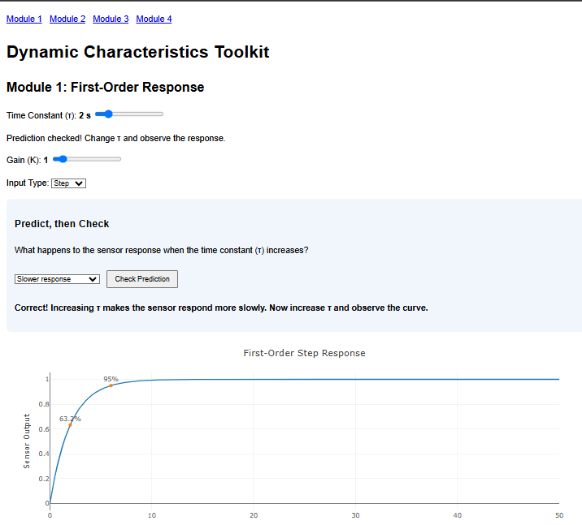
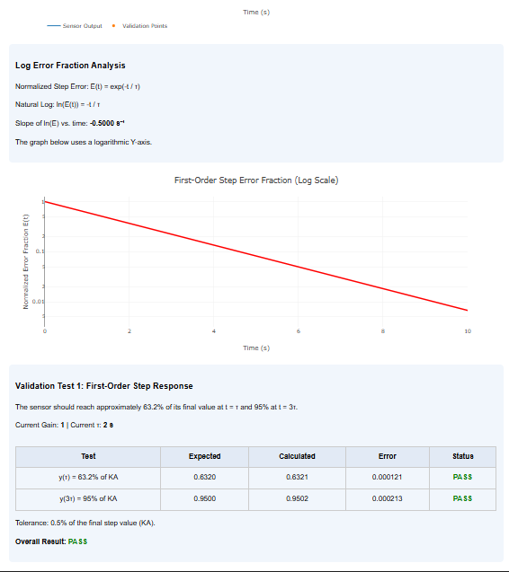
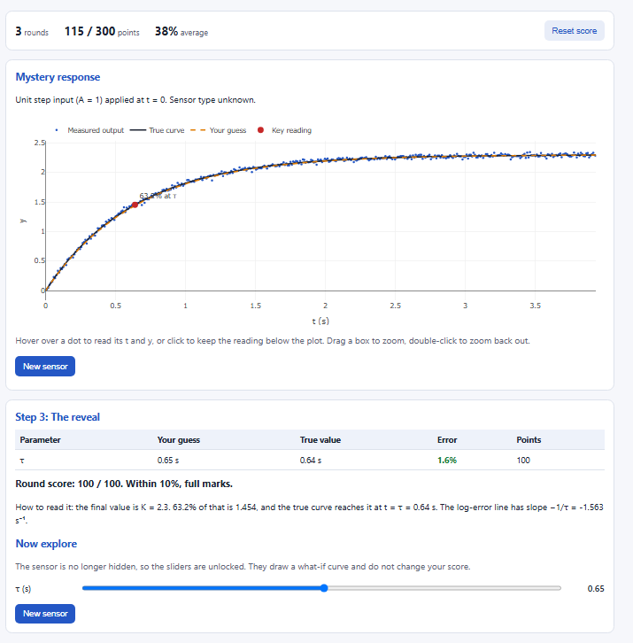

# ENCS4380 – Dynamics & PID Control Toolkit

An interactive web toolkit developed for ENCS4380 – Interfacing Techniques at Birzeit University.

**Instructor:** Dr. Wasel Ghanem  
**Group:** 35

The toolkit includes two assignments:

- **Homework 1 – Dynamic Characteristics:** Exploring the time-domain and frequency-domain behavior of first-order and second-order systems.
- **Homework 2 – PID Control Toolkit:** Understanding feedback control and the effects of proportional, integral, and derivative controllers.

All modules run interactively in the browser.

**Live site:** https://sanabelamer1234-lab.github.io/encs4380-dynamics-group35/

---

## Homework 1 – Dynamic Characteristics

| # | Module | What it shows |
|---|--------|---------------|
| 1 | [First-order time response](https://sanabelamer1234-lab.github.io/encs4380-dynamics-group35/) | Step and ramp responses, 63.2% and 95% points, ramp lag, steady-state error, and log error-fraction plot |
| 2 | [First-order frequency response](https://sanabelamer1234-lab.github.io/encs4380-dynamics-group35/module2.html) | Input/output sine waves, amplitude ratio, phase lag, Bode plot, cutoff frequency, and dynamic error |
| 3 | [Second-order response](https://sanabelamer1234-lab.github.io/encs4380-dynamics-group35/module3.html) | Damping cases, performance metrics, s-plane poles, state-space representation, phase plane, and RK4 simulation |
| 4 | [Guess the Sensor](https://sanabelamer1234-lab.github.io/encs4380-dynamics-group35/module4.html) | Hidden random sensor with noise, parameter estimation, true response reveal, and scoring |

---

## Homework 2 – PID Control Toolkit

Homework 2 extends the original toolkit by introducing closed-loop feedback control, numerical simulation, and PID controller tuning.

### PID Modules

| # | Module | Owner | Description | Status |
|---|--------|-------|-------------|--------|
| P1 | [PID Playground](https://sanabelamer1234-lab.github.io/encs4380-dynamics-group35/p1.html) | Sanabel Amer | Interactive PID simulation for first-order and second-order plants | Completed |
| P2 | Slow Sensor in the Loop | To be confirmed | Investigating the effect of sensor lag on closed-loop performance | In progress |
| P3 | Digital PID | To be confirmed | Exploring sampling time, digital PID control, and anti-windup | In progress |
| P4 | Tuning Challenge | To be confirmed | Tuning PID gains to meet performance specifications | In progress |

### P1 – PID Playground

The PID Playground demonstrates how proportional, integral, and derivative gains affect the response of a closed-loop system.

**Features:**

- First-order plant simulation
- Second-order plant simulation
- Adjustable Kp, Ki, and Kd gains
- Adjustable setpoint and plant parameters
- Closed-loop block diagram with negative feedback
- Output versus setpoint plot
- Control signal plot with actuator saturation limits
- Live rise time, overshoot, settling time, and steady-state error
- Predict, then Check interactive activity
- Explanation of proportional, integral, and derivative control
- Built-in validation checks
- Responsive interface for desktop and mobile devices

### Plant Models

**First-order plant:**

G(s) = K / (τs + 1)

**Second-order plant:**

G(s) = Kωn² / (s² + 2ζωn s + ωn²)

Where:

- K: Plant gain
- τ: Time constant
- ζ: Damping ratio
- ωn: Natural frequency

### Numerical Simulation

The closed-loop system is simulated using the fourth-order Runge–Kutta (RK4) method.

The controller includes:

- Proportional action
- Integral action
- Filtered derivative action
- Actuator saturation
- Conditional anti-windup

Performance metrics are calculated from the simulated step response.

An end-of-simulation stationarity check is used to avoid reporting unconfirmed steady-state values when the response has not sufficiently settled.

### Shared PID Simulation Engine

The file `pid-core.js` provides reusable functions:

- `simulatePID(options)` – Runs the closed-loop PID simulation.
- `calculateMetrics(result, target)` – Calculates response performance metrics.

The engine supports first-order and second-order plants and an optional slow feedback sensor through the `sensorTau` parameter.

This shared engine can also be used and extended in P2.

**P1 Live Page:**

https://sanabelamer1234-lab.github.io/encs4380-dynamics-group35/p1.html

---

## Team

| Member | GitHub | Homework 1 | Homework 2 |
|--------|--------|------------|------------|
| Sanabel Amer | [sanabelamer1234-lab](https://github.com/sanabelamer1234-lab) | Module 1 | P1 – PID Playground |
| Maria Massad | [mariamassad05](https://github.com/mariamassad05) | Module 2 | To be confirmed |
| Shahd Hamda | [shahdhamda2005](https://github.com/shahdhamda2005) | Module 3 | To be confirmed |
| Tala Hussary | [TalaHussary](https://github.com/TalaHussary) | Module 4 | To be confirmed |

---

## Homework 1 – Validation Checks

| Test | Expected Result | Module |
|------|-----------------|--------|
| 1 | y(τ) = 0.632 KA and y(3τ) ≈ 0.95 KA | Module 1 |
| 2 | τ = 0.2 s, input sin(2t): amplitude ratio ≈ 0.93 and phase lag ≈ 21.8° | Module 2 |
| 3 | 100 Hz with maximum 5% dynamic error: τmax ≈ 0.52 ms; phase lag ≈ 9.3° at 50 Hz | Module 2 |
| 4 | ζ = 0.5: overshoot ≈ 16.3% | Module 3 |
| 5 | ζ = 1: no overshoot | Module 3 |
| 6 | m = 1, b = 2, k = 4: eigenvalues and poles = −1 ± j1.732 | Module 3 |

---

## Homework 2 – P1 Validation Checks

The validation tests use the reference first-order plant:

G(s) = 1 / (s + 1)

| Validation Test | Expected | Actual | Result |
|-----------------|----------|--------|--------|
| P-only steady-state error (Kp = 9) | 10.00% | 10.000% | PASS |
| P-only closed-loop time constant | 0.100 s | 0.0996 s | PASS |
| PI natural frequency (Kp = 1, Ki = 1) | 1.000 rad/s | 1.000 rad/s | PASS |
| PI damping ratio (Kp = 1, Ki = 1) | 1.000 | 1.000 | PASS |
| PI steady-state error | ≈ 0% | 0.0000% | PASS |

**Validation Result: 5/5 PASS**

The numerical simulation results were compared with the theoretical values provided in the assignment.

The validation checks can also be executed directly from the P1 webpage.

---

## Screenshots

### Module 1: First-order time response

### Module 2: First-order frequency response

.png>)

.png>)

.png>)

.png>)

### Module 3: Second-order response

.png>)

.png>)

.png>)

.png>)

### Module 4: Guess the Sensor

.png>)

.png>)

---

## Built With

- HTML5
- CSS3
- JavaScript
- [Plotly.js](https://plotly.com/javascript/)
- Fourth-order Runge–Kutta (RK4)
- GitHub Pages

The toolkit runs directly in the browser without requiring a backend server or user login.

---

## AI Use

AI tools, including ChatGPT, were used as learning and coding assistants to help understand the code, explain programming concepts, identify errors, and support debugging and corrections during development.

The group reviewed and tested the implementation, compared the simulation results with the required validation checks, and verified the functionality of the interactive modules.

Each team member is responsible for understanding and explaining the code and equations used in their assigned module.

---

## Submission

**Homework 1:** Dynamic Characteristics Interactive Toolkit.

**Homework 2:** PID Control Toolkit.

The final Homework 2 submission will include the GitHub Pages link and a GitHub release tagged `v2.0` after the remaining modules and project application are completed.
