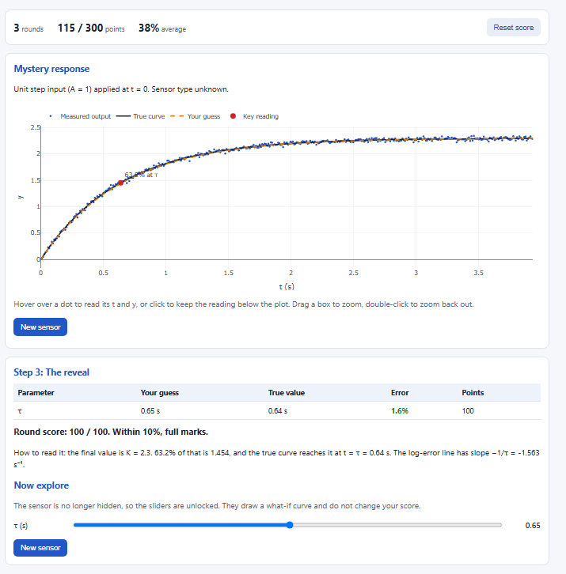

# -encs4380-dynamics-group35
ENCS4380 Dynamic Characteristics Interactive Toolkit

An interactive web toolkit that shows how real sensors lag behind what they measure.
Homework 1 for ENCS4380 Interfacing Techniques, Birzeit University.

**Live site:** https://sanabelamer1234-lab.github.io/encs4380-dynamics-group35/

## Modules

| # | Module | What it shows |
|---|--------|---------------|
| 1 | [First-order time response](https://sanabelamer1234-lab.github.io/encs4380-dynamics-group35/) | Step and ramp responses, the 63.2% and 95% points, ramp lag and steady-state error, and the log error-fraction plot |
| 2 | [First-order frequency response](https://sanabelamer1234-lab.github.io/encs4380-dynamics-group35/module2.html) | Input and output sines, amplitude ratio and phase lag, Bode plot with cutoff, and dynamic error |
| 3 | [Second-order response](https://sanabelamer1234-lab.github.io/encs4380-dynamics-group35/module3.html) | The three damping cases, metrics read off the curve, s-plane poles, and the state-space panel with phase plane and RK4 simulation |
| 4 | [Guess the Sensor](https://sanabelamer1234-lab.github.io/encs4380-dynamics-group35/module4.html) | A hidden random sensor with noise: estimate its parameters, then see the true curve and your score |

## Team

| Member | GitHub | Module |
|--------|--------|--------|
| [Sanabel Amer] | sanabelamer1234-lab | Module 1 |
| [Maria Massad] | mariamassad05 | Module 2 |
| [Shahd Hamda] | shahdhamda2005 | Module 3 |
| [Tala Hussary] | TalaHussary | Module 4 |

## Validation checks

| Test | Result checked | Page |
|------|----------------|------|
| 1 | y(τ) = 0.632 KA and y(3τ) = 0.95 KA | Module 1 |
| 2 | τ = 0.2 s, input sin 2t: amplitude ratio 0.93, lag 21.8° | Module 2 |
| 3 | 100 Hz with at most 5% dynamic error: τmax ≈ 0.52 ms, lag 9.3° at 50 Hz | Module 2 |
| 4 | ζ = 0.5: overshoot 16.3% | Module 3 |
| 5 | ζ = 1: no overshoot | Module 3 |
| 6 | m = 1, b = 2, k = 4: eigenvalues of A = −1 ± j1.732, equal to the poles | Module 3 |

## Screenshots

### Module 1

### Module 2

### Module 3

### Module 4

## Built with

HTML, JavaScript and [Plotly.js](https://plotly.com/javascript/), hosted on GitHub Pages. It needs no server or login.

## AI use

We worked on this assignment independently as a group. We used AI tools as learning assistants to better understand concepts, clarify difficult topics, correct mistakes, and improve parts of our work. The implementation and overall work were done by us, with AI used for guidance and learning.
